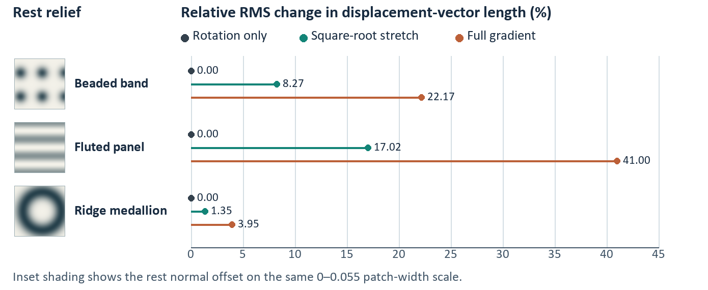

# Detail Transport

This repository reproduces the synthetic experiment in §3.4 and Figure 3 of Ziang Zhao's *Detail-Preserving Sketch-Guided Editing of Layered 3D Game Assets*. The question is what happens to an existing relief when its base bends and stretches. The code applies three transport rules to the same base, measures changes inside the moving region and at its protected edge, and checks the result when the handles return to rest.

**Proposal snapshot:** Git tag `pilot-v1.0`. The [original measurements](reference/measures.csv), [extent fits](reference/contours.csv), and [Figure 3](reference/transport_check.png) are versioned alongside the code. The [animated cycle](reference/cycle_demo.gif) shows all eleven states. The experiment runs on a CPU using Python, NumPy, and Pillow.

The initial commit `45e0518` records the contents of the earlier `transport_pilot.zip` (SHA-256 `c5e2711be14f251149088a6c777be96a145280f288772412ac78864a805f0398`). Later commits separate reference outputs from new runs. The tagged version is the baseline for extending the work.



## Reproduce the proposal

From the repository root, use Python 3.12 and the pinned [dependencies](requirements.txt). The original measurements used CPython 3.12.14, NumPy 2.3.5, and Pillow 13.0.0 on Windows. For a copy delivered as a Git bundle, first run `git clone detail-transport.bundle detail-transport` from the directory containing the bundle, then `cd detail-transport`. To reproduce the cited version after the repository has advanced, run `git switch --detach pilot-v1.0`.

**Windows PowerShell**

```powershell
py -3.12 -m venv .venv
.\.venv\Scripts\python.exe -m pip install -r requirements.txt
.\.venv\Scripts\python.exe pilot.py
.\.venv\Scripts\python.exe verify.py
.\.venv\Scripts\python.exe figure.py
```

**macOS or Linux**

```sh
python3.12 -m venv .venv
.venv/bin/python -m pip install -r requirements.txt
.venv/bin/python pilot.py
.venv/bin/python verify.py
.venv/bin/python figure.py
```

The default run creates `runs/pilot/` and records its configuration, library versions, and Git revision when available. The verifier should print **PASS: 3 assets and manifests, 99 measurements, 6 contour fits.** It compares row identities, discrete fields, and mesh arrays against the [reference snapshot](reference/). Floating-point checks use a relative tolerance of 10⁻⁸ and an absolute tolerance of 10⁻¹². Fonts and rasterization can vary across platforms. Open `runs/pilot/transport_check.png` to inspect the chart and `runs/pilot/cycle_demo.gif` to see the deformations.

To repeat a run, choose a fresh output directory. With the virtual environment's interpreter selected:

```sh
python pilot.py --config config.json --output runs/reproduction-02
python verify.py runs/reproduction-02
python figure.py --run-dir runs/reproduction-02
python -m unittest discover -s tests
```

## What the code measures

1. **Deform a known base.** A unit square is triangulated into 512 faces on a 17 × 17 vertex grid. The left quarter is pinned, and the right strip is driven horizontally and out of plane. The interior is solved with 35 iterations of uniform-weight, local/global as-rigid-as-possible deformation (ARAP). The amplitudes go from 0 to 1 and back to 0 in ten increments. Each pose has its own deterministic initialization. [ARAP method](https://doi.org/10.2312/SGP/SGP07/109-116)
2. **Carry three procedural reliefs through the same poses.** The beaded band, fluted panel, and ridge medallion use different vector fields on the same UV chart. For each face, a map J sends its two rest edges and unit normal to their deformed counterparts. If J = U diag(s) Vᵀ, the displaced point is the deformed base point plus U diag(sᵖ) Vᵀ applied to its original offset. The exponent p is 0 for rotation only, 0.5 for square-root stretch, and 1 for the full gradient. All rules sample the rest field on every step. Mapping unit normal to unit normal fixes the normal-depth convention for this experiment.
3. **Measure the response at locations with known correspondence.** At the 384 face centres outside the fully pinned strip, compute RMS change in offset-vector length divided by RMS rest length. On a shared edge, evaluate the same rest displacement at the midpoint through each incident face. Their distance reveals disagreements that can remain invisible in the animation, which averages offsets at vertices.
4. **Check a one-dimensional contour fit.** A known amplitude of 0.7 under square-root stretch generates a target right-edge extent. Bisection fits the target using either the base or displaced extent. Both fits are scored on the resulting displaced extent. This is a controlled consistency check of one projected coordinate.

## Results and interpretation

| Relief field | Rotation only | Square-root stretch | Full gradient | Base-only fit: final extent error |
|---|---:|---:|---:|---:|
| Beaded band | <0.001% | 8.27% | 22.17% | 0.018706 |
| Fluted panel | <0.001% | 17.02% | 41.00% | 0.045500 |
| Ridge medallion | <0.001% | 1.35% | 3.95% | 0.0000425 |

The percentages are peak changes in **offset length**. Whether length should change depends on the artist's brief. Rotation preserves each vector's length by construction, although the base can still spread the attachment points apart. Extent errors are fractions of the unit rest width. Fitting with the same displaced model that generated the target gave errors below 2 × 10⁻¹⁵ on all three reliefs.

All nine field-policy combinations returned to rest within **2.30 × 10⁻¹⁶ patch widths** in RMS displaced-centre distance. This tests repeatability under a known reset. A history-dependent edit sequence would start each new solve from the last approval. At peak deformation, the largest protected-boundary gap for each combination ranged from **0.00216 to 0.02089 patch widths**, even though sampled protected centres stayed fixed. This observation motivates explicit boundary checks in the full study.

The 99 measurement rows are repeated observations of **three fields on one mesh**. The scope is a single chart, independently solved poses, and exact handles. Artist-defined detail policies, multiple UV charts, serial optimization, visual preference, and repair time remain open experiments.

## Files and units

| File | Contents |
|---|---|
| [pilot.py](pilot.py), [config.json](config.json) | Synthetic fields, base solver, transport, measurement, visualizations, and default experiment settings. |
| [figure.py](figure.py), [verify.py](verify.py) | Build the peak-response figure from a run's CSV and compare a reproduced run with the proposal snapshot. |
| [reference/asset_manifest.csv](reference/asset_manifest.csv), `reference/*.npz` | Mesh counts and origins, rest vertices, triangles, UVs, displacement samples, rest frame, and protected faces. The three fields are generated locally. |
| [reference/measures.csv](reference/measures.csv) | One row per field, policy, and step. Length-change NRMSE is a ratio. Position errors and gaps are in patch widths. `geometric_check_failed` counts failures of finiteness, positive projected base-triangle orientation, or the protected-centre tolerance. Self-intersection and boundary acceptance require separate tests. |
| [reference/contours.csv](reference/contours.csv) | Six fits with the target x coordinate, recovered handle amplitude, and absolute displaced-extent error in patch widths. |
| `runs/<run-name>/` | Local outputs, figures, configuration, and environment record. Git ignores this directory. |

## Extend the experiment

Create a branch from `pilot-v1.0` and copy `config.json` for the next experiment. The runner accepts different cycle schedules, stretch or bend magnitudes, grid resolutions, field subsets, and transport exponents. Keep at least two vertex columns in each handle strip and one free column between them. The extent control relies on both columns adjacent to the right edge being driven. Give each experiment a new output directory and store its configuration with the study. The verifier targets the tagged proposal configuration. For a new condition, retain the original regression run and compare your new condition against its own recorded hypotheses and metrics.

The current solver uses a dense Laplacian inverse for the small synthetic grid. Moving to production meshes will require a sparse factorization. An informative next test is to keep a boss circular and let an adjacent groove lengthen on a multi-chart asset. Give each feature an independently specified geometric target and start the second edit from the first approval. This directly tests the two assumptions that the present patch experiment simplifies.
